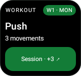
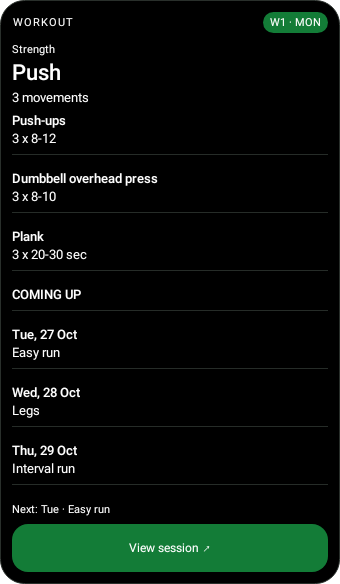

# Workout

Turn your workout PDF into a daily Android home-screen widget.

Workout grew out of my own running and strength-training routine. I used AI to help create my plans, then built this app with AI to make those plans easier to use every day. Import a PDF, review what was read, and see today's session at a glance.

**Android 8.0+ · No account · On-device PDF reading and OCR · Black, white and green**

[Download the latest APK](https://github.com/joejojy/workout/releases/latest) · [Report an issue](https://github.com/joejojy/workout/issues)

<table><tr><td></td><td></td></tr></table>

## Install and try it

1. Download **Workout-debug.apk** from the [latest release](https://github.com/joejojy/workout/releases/latest).
2. Open the APK on your Android phone and allow installation from the app you used to download it if Android asks.
3. Open **Workout → Import → Try sample plan**, or **Choose PDF** to select your own file.
4. Compare the extracted sessions and dates with the original. Correct any unclear details, acknowledge the review, and activate the plan.
5. Tap **Add home-screen widget**, or long-press your home screen and find **Workout** in Widgets.
6. Resize it. Use **Import → Test widget sizes** to compare five presets, and **Widget display options** to choose Auto, Glance, or Detailed per widget.

This is an early, debug-signed preview distributed through GitHub, not a Play Store release.

## What it does

- Imports running, strength and rest schedules from PDFs using weekday sections and dated weekly tables.
- Reads printed English/Latin-script scans and mixed text/image PDFs using a bundled OCR model. No model download or PDF upload is required.
- Handles wrapped instructions and separate Push/Pull/Legs exercise libraries in supported layouts.
- Detects written dates or a plan month automatically. Explicit weekly ranges can extend into another month. Undated plans align to the current training week, with that inference shown for review.
- Preserves an existing active plan while a replacement is being reviewed. Tracks individual session completion with undo.
- Adapts the widget to width, height and font size. Small summaries identify omitted details; larger widgets can scroll or show upcoming sessions.
- Fits the black card to its content. The unused launcher slot is transparent; Android still reserves the grid cells you selected.
- Offers original-page comparison, extracted text, source-page links where detected, reading progress and cancellation.

## Example PDFs

The [examples](examples) folder contains a fictional selectable-text plan and an image-only version of the same plan. They are demonstration data, not a personalized fitness recommendation.

**No personal workout PDFs, historical fitness metrics or private test captures are included in this repository or the public APK.**

## PDF support and limits

PDF layouts vary enormously. This is not a universal document or AI interpreter. Review every import, especially dates, units and OCR numbers. Unclear values are flagged where detected and retained without guessing. OCR can still make mistakes that are not automatically flagged.

Supported paths include weekday headings, abbreviated weekday rows, dated weekly schedule tables, wrapped descriptions and reusable strength tables. Unusual calendar grids, arbitrary multi-column prose, handwriting, unsupported scripts, password-protected PDFs and unreadable scans may need correction or a different export.

Limits: 20 MB, 50 pages, 52 weeks, 400 session templates and 500,000 extracted characters. Missing prescriptions stay unspecified rather than becoming invented rest days. General or optional material can remain in **Read extracted text** or the original PDF rather than being assigned to a particular session.

Historical plans keep their original dates. If an old plan says **This plan has ended**, use the Plan view or date navigation to inspect its sessions. Imported plans are not automatically shifted to today.

There is no cloud sync, account, GPS recording, interval timer or training-plan generation inside the app. Background widget updates can be delayed by Android power saving. Physical launchers and screen sizes can differ from emulator tests.

## Build from source

Open this folder in Android Studio, or use Java 17, Android SDK 35, build-tools 34.0.0 and the included Gradle 8.9 wrapper.

Create an untracked `local.properties` with your SDK location, for example:

```properties
sdk.dir=C:/Users/YOUR_NAME/AppData/Local/Android/Sdk
```

On Windows:

```powershell
.\gradlew.bat testDebugUnitTest lintDebug assembleDebug
```

On macOS/Linux:

```sh
chmod +x gradlew
./gradlew testDebugUnitTest lintDebug assembleDebug
```

Output: `app/build/outputs/apk/debug/app-debug.apk`. Dependencies download on the first build. Android Studio normally manages the SDK location for you.

To run the on-device text/scanned-sample test with an emulator or connected Android device:

```sh
./gradlew connectedDebugAndroidTest
```

To regenerate the fictional PDF examples:

```sh
python -m pip install -r requirements-dev.txt
python tools/create_sample_plan.py
```

The four widget XML shape layouts are generated by `python tools/write_widget_layouts.py`. Run it after editing their shared definitions.

## Tests and project notes

The public suite uses fictional examples and covers import types, date boundaries, draft isolation, completion, unknown activities, duplicate headings, and 105 day/size/display-mode combinations. A native test imports both selectable and scanned examples without replacing the active plan. [Validation](docs/VALIDATION.md) records release checks and distinguishes the public suite from earlier private-fixture testing.

[Architecture](docs/ARCHITECTURE.md) · [Privacy](PRIVACY.md) · [Contributing](CONTRIBUTING.md) · [Third-party notices](THIRD_PARTY_NOTICES.md)

## License

Project source is available under the [MIT license](LICENSE). Third-party components retain their own licenses and terms.
